# mojis

Custom Slack emojis from the Mentimeter workspace: 82 added by Peter Assi Geijer, plus selected favorites.

87 emojis imported on 6 November 2026. Original image formats and GIF animations are preserved.

## Emoji gallery

| Emoji | Name |
| --- | --- |
| 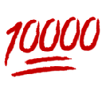 | `:10000:` |
|  | `:100000:` |
|  | `:aawesome:` |
|  | `:alfa-romeo:` |
| 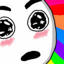 | `:amaze:` |
| 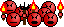 | `:angry-mob:` |
| 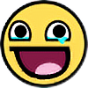 | `:awesomeness:` |
| 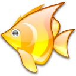 | `:babelfish:` |
| 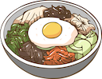 | `:bibimbap:` |
| 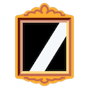 | `:black_mirror:` |
|  | `:bolton-wanderers-fc:` |
| 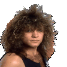 | `:bonjovi-spin:` |
| 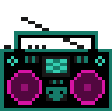 | `:boombox:` |
| 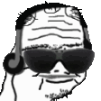 | `:boomer-jam:` |
|  | `:brynas:` |
| 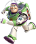 | `:buzzlightyear:` |
| 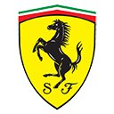 | `:canclini:` |
|  | `:cloudflare:` |
|  | `:codex:` |
|  | `:color-wheel:` |
|  | `:credit-card-with-wings:` |
| 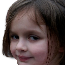 | `:disaster-girl:` |
| 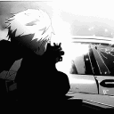 | `:driveby:` |
| 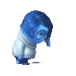 | `:e2e:` |
| 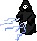 | `:emperor-palpatine:` |
|  | `:erase:` |
| 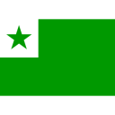 | `:esperanto:` |
| 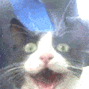 | `:excited-cat:` |
| 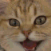 | `:excited_cat:` |
| 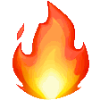 | `:fire-scroll:` |
| 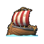 | `:flagship-party:` |
|  | `:fyi1:` |
| 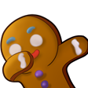 | `:ginger_dab:` |
| 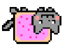 | `:glitch-nyancat:` |
| 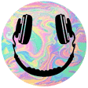 | `:glitch-smiley:` |
| 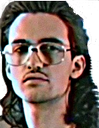 | `:hackerman:` |
| 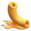 | `:hackerone:` |
| 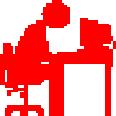 | `:head-desk-party:` |
| 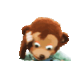 | `:horror:` |
| 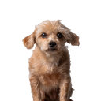 | `:iris:` |
| 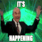 | `:its-happening:` |
| 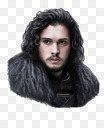 | `:john_snow:` |
|  | `:just-do-it-swoosh:` |
|  | `:kinder:` |
| 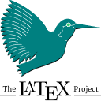 | `:latex:` |
|  | `:leet:` |
| 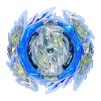 | `:let-it-rip:` |
| 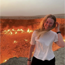 | `:lina-this-is-fine:` |
|  | `:live-creation-team:` |
| 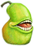 | `:lolwut:` |
|  | `:manana:` |
| 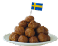 | `:meatballs:` |
|  | `:menti-live:` |
|  | `:menti-pulse-intensifies:` |
|  | `:menti-pulse-pulsating:` |
| 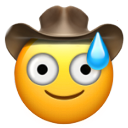 | `:mild-panic-cowboy:` |
| 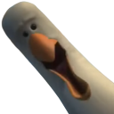 | `:mine_seagull:` |
| 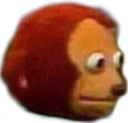 | `:monkey-look-away:` |
| 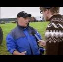 | `:najs:` |
|  | `:netscape:` |
| 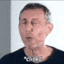 | `:noice-guy:` |
| 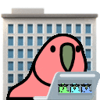 | `:office-parrot:` |
| 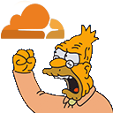 | `:old-man-yells-at-cloudflare:` |
| 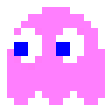 | `:pacman-speedy:` |
|  | `:pc:` |
|  | `:peter-intensifies:` |
|  | `:photoshop:` |
| 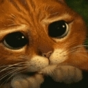 | `:please-cat:` |
|  | `:public-enemy:` |
|  | `:rasta:` |
|  | `:reddit_pranked:` |
|  | `:reddit_pranked-1:` |
|  | `:respect:` |
|  | `:skellefte:` |
| 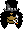 | `:slash:` |
| 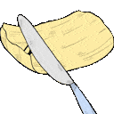 | `:smooth:` |
| 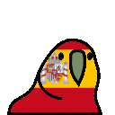 | `:spanish-parrot:` |
| 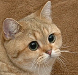 | `:starecat:` |
|  | `:this-is-the-way:` |
|  | `:today-i-learned:` |
| 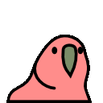 | `:ultra-fast-parrot:` |
|  | `:uppland:` |
|  | `:vroom:` |
|  | `:winning:` |
|  | `:yes-sir-mushroom:` |
|  | `:yodawg:` |
|  | `:zany_cowboy:` |

## Adding emojis

Add the original image to `emojis/`, using its Slack name as the filename, and add a matching preview and name to the gallery above. Keep the gallery alphabetically sorted.
